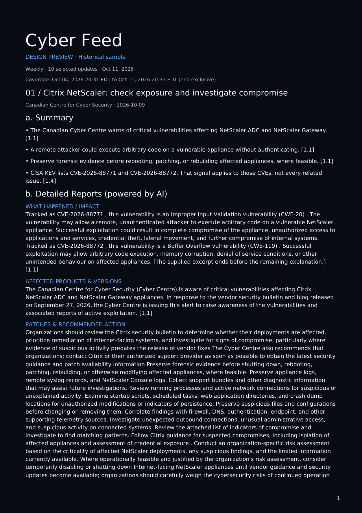
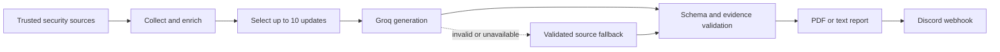

<div align="center">

# Cyber Feed

**Evidence-linked cyber briefings, delivered to Discord.**

[](https://github.com/infosecmanav/CyberFeed/actions/workflows/test.yml)
[](https://www.python.org/)
[](https://console.groq.com/)
[](https://discord.com/)

Daily and weekly PDF or text reports from trusted security sources.

</div>

> [!IMPORTANT]
> **Groq is the only supported AI provider for this project setup.** The scheduled workflow is maintained and tested with `AI_PROVIDER=groq` and `AI_MODEL=openai/gpt-oss-120b`.

> [!NOTE]
> **Scheduled delivery is not guaranteed at an exact minute.** GitHub Actions uses a best-effort scheduler. Cyber Feed targets the Toronto morning windows below, but GitHub may start a run minutes or hours later.



## What Cyber Feed does

Cyber Feed collects security updates from government agencies, product vendors, threat research teams, and selected news publishers. It selects up to ten useful updates, asks Groq to produce evidence-grounded editorial content, validates the result, renders a black-and-blue report, and sends it to Discord.

Each update follows the same format:

1. **Summary** — a concise overview of the event and why it matters.
2. **Detailed Reports (powered by AI)** — affected products, exploitation evidence, technical context, remediation, and other facts supported by the source material.
3. **References** — links and citations for the evidence used in that update.

Optional diagrams appear only when the source evidence supports them and they improve understanding.



## Quick start with GitHub Actions

This is the recommended deployment. It runs in GitHub, so your computer does not need to remain on.

### 1. Use the repository

If this is your repository, use it directly. Otherwise, fork it to your GitHub account. Open the repository's **Actions** tab and enable workflows if GitHub prompts you.

### 2. Create a Discord webhook

In the destination Discord channel, open **Channel Settings → Integrations → Webhooks**, create a webhook, and copy its URL. Treat this URL like a password.

### 3. Create a Groq API key

Create a key at [console.groq.com/keys](https://console.groq.com/keys). Use only a Groq key; keys from other AI providers are not supported by this setup.

### 4. Add GitHub Actions secrets

Open **Settings → Secrets and variables → Actions → Secrets → New repository secret** and add:

| Secret | Value |
| --- | --- |
| `AI_API_KEY` | Your Groq API key |
| `DISCORD_WEBHOOK_URL` | Your Discord channel webhook URL |

Secrets are encrypted and are not printed in workflow logs.

### 5. Add GitHub Actions variables

On the same page, select **Variables → New repository variable** and add:

| Variable | Value | Required |
| --- | --- | --- |
| `AI_PROVIDER` | `groq` | Yes |
| `AI_MODEL` | `openai/gpt-oss-120b` | Yes |
| `BRIEFING_FORMAT` | `pdf` or `text` | No; defaults to `pdf` |

Leave `AI_BASE_URL` unset. Cyber Feed uses Groq's standard endpoint automatically.

### 6. Run a test delivery

Open **Actions → Scheduled Discord Briefings → Run workflow**, select `daily` or `weekly` and `pdf` or `text`, then choose **Run workflow**.

A manual run starts as soon as a GitHub runner is available. A complete Groq free-tier report can take several minutes because requests are paced to stay within token limits. Confirm that the workflow succeeds and the report appears in Discord.

## Delivery schedule

Report windows use `America/Toronto`, including daylight saving time. GitHub cron expressions use UTC internally, while the application calculates the correct Toronto reporting window.

| Report | Target window | Content covered |
| --- | --- | --- |
| Daily | Every day after **8:50 AM Toronto time** | Previous local 8:50 AM through the current 8:50 AM |
| Weekly | Friday after **8:30 AM Toronto time** | Previous Friday 12:00 AM through Thursday 11:59 PM |

These are **target windows, not exact send times**. GitHub may delay scheduled jobs because of platform load. The workflow provides multiple opportunities across a recovery window and uses a successful-delivery marker so that:

- a delayed opportunity can still deliver the correct completed period;
- a failed attempt can be followed by another opportunity; and
- a successful period is not posted twice.

Report generation and Discord upload begin after GitHub starts the job. Collection, Groq generation, validation, and PDF rendering add processing time. For exact-time delivery, run the same command from an external scheduler with a timing guarantee.

Schedules are defined in [.github/workflows/briefing.yml](.github/workflows/briefing.yml). Scheduled workflows run only from the default branch. GitHub may disable schedules in a public repository after 60 days without repository activity; re-enable the workflow from the **Actions** page if that happens.

## Sources

The registry is maintained in [sources.yaml](sources.yaml).

| Role | Sources |
| --- | --- |
| Government | Canadian Centre for Cyber Security; CISA CSAF advisories and KEV enrichment |
| Vendor advisories | Microsoft MSRC; Cisco Security Advisories; Fortinet PSIRT |
| Threat research | Google Threat Intelligence / Mandiant; Cisco Talos |
| Reporting and discovery | The Record; BleepingComputer; The Hacker News |

Primary advisories take priority when duplicate coverage is available. Publisher balancing limits the selected report to three updates from one publisher. Source retrieval failures and missing evidence remain visible as coverage warnings.

## AI generation and validation

Cyber Feed sends the collected evidence to Groq in small batches. The default setup uses one update per request and a 4096-token output budget to fit typical free-tier limits.

Generated content must pass local checks for:

- the required report structure and story order;
- valid evidence identifiers and exact supporting quotations;
- source-supported CVE and version references; and
- evidence-backed diagram steps and relationships.

When a draft fails validation, Cyber Feed requests one correction. If the correction still fails, the affected update uses a clearly labeled, validated source fallback. Valid AI updates stay unchanged, and the scheduled report can still be delivered without accepting unsupported AI text.

The fallback count is shown in the Discord message and report metadata. It means the report used collected source text for those updates; it does not mean the entire report failed.

Advanced Groq settings are optional:

| Variable | Default | Purpose |
| --- | --- | --- |
| `AI_MAX_OUTPUT_TOKENS` | `4096` | Maximum generated tokens per request |
| `AI_BATCH_SIZE` | `1` | Updates sent in each Groq request |
| `AI_JSON_MODE` | `true` | Ask Groq to enforce JSON output; local validation always remains active |
| `AI_REPAIR_ATTEMPTS` | `1` | Correction attempts before validated source fallback |

Do not change these defaults unless the Groq account's current limits require it. A full run can make several API requests and consume free-tier quota.

## Local installation

Python 3.11 or later is required.

```bash
git clone https://github.com/infosecmanav/CyberFeed.git
cd CyberFeed
python3 -m venv .venv
source .venv/bin/activate
python -m pip install -r requirements.txt
```

On Windows PowerShell, activate the environment with:

```powershell
.venv\Scripts\Activate.ps1
```

Export the Groq configuration in the terminal that will run Cyber Feed:

```bash
export AI_PROVIDER="groq"
export AI_MODEL="openai/gpt-oss-120b"
read -s -p "Groq API key: " AI_API_KEY
echo
export AI_API_KEY
```

For macOS `zsh`, use `read -s "AI_API_KEY?Groq API key: "` instead of the Bash `read` command above.

Build a local report:

```bash
python -m cyberbrief.cli build --ai --period daily --format all --out site
```

The `site` directory will contain `briefing.json`, `briefing.txt`, and `briefing.pdf`. Use `--period weekly` for a weekly report and add `--scheduled-window` to use the completed Toronto delivery window.

A local `.env` file is ignored by Git but is **not loaded automatically**. Export variables in your shell or use a secret manager. Never commit an API key, webhook URL, or Discord bot token.

## Optional interactive Discord bot

Scheduled webhook delivery does not need a bot token. The optional bot provides private, on-demand `/briefing` commands and must run continuously on your own host.

```bash
export AI_PROVIDER="groq"
export AI_MODEL="openai/gpt-oss-120b"
export AI_API_KEY="YOUR_GROQ_KEY"
export DISCORD_BOT_TOKEN="YOUR_DISCORD_BOT_TOKEN"
python -m cyberbrief.discord_bot
```

Available commands:

```text
/briefing_settings format:pdf
/briefing period:weekly
/briefing period:daily format:text
```

Preferences are stored in `.state/preferences.sqlite3`. Closing the process stops on-demand commands but does not affect scheduled GitHub Actions delivery.

## Troubleshooting

| Problem | What to check |
| --- | --- |
| No scheduled report | Open **Actions → Scheduled Discord Briefings**. Confirm the workflow is enabled and allow for GitHub scheduling delays. |
| Manual workflow does not deliver | Confirm both repository secrets exist, the Discord webhook is valid, and the selected channel permits webhook posts. |
| AI configuration missing | Set `AI_API_KEY`, `AI_PROVIDER=groq`, and `AI_MODEL=openai/gpt-oss-120b`. Remember that `.env` is not auto-loaded. |
| HTTP 401 | Replace the Groq key in the `AI_API_KEY` repository secret. Check that the key is active and was copied without extra characters. |
| HTTP 413 | Remove stale overrides or use `AI_BATCH_SIZE=1` and `AI_MAX_OUTPUT_TOKENS=4096`. |
| HTTP 429 | The Groq free-tier quota or rate limit is exhausted. The report uses source fallback where possible; wait for the provider limit to reset. |
| AI output rejected | Read the exact validation field in the log. The workflow requests one correction, then uses validated source fallback for that update. |
| Coverage warnings | One or more sources could not be retrieved or parsed. Review the named source and its original advisory. |
| `No module named discord` | Activate `.venv` and install `requirements.txt` using that environment's Python interpreter. |

Generated JSON, text, PDF, and safe diagnostic files are retained as GitHub Actions artifacts for seven days. Rejected AI text and credentials are not stored in diagnostics.

## Development

```bash
python -m pip install -r requirements-dev.txt
python -m pytest -q
python -m cyberbrief.cli build --fixtures --period weekly --format all --strict --out site
```

The [Tests workflow](.github/workflows/test.yml) runs on pushes to `main` and on pull requests. The portable report instructions are in [SKILL.md](SKILL.md), and design samples are available in [docs/editorial-preview](docs/editorial-preview/README.md).

## Security

- Store Groq keys, webhook URLs, and bot tokens only in GitHub Secrets or a trusted secret manager.
- Rotate any credential that was pasted into chat, committed, or exposed in logs.
- Keep TLS verification and advisory checksum checks enabled.
- Review the linked primary advisory before applying remediation in production.
- Treat AI text as an evidence-linked briefing, not as authorization to change systems.
